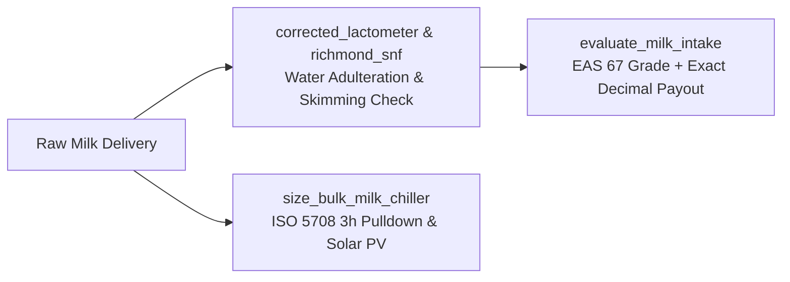

# dairy-mcc

[](https://github.com/codesphere-u/dairy-mcc/actions/workflows/ci.yml)
[](LICENSE)
[](pyproject.toml)
[](pyproject.toml)

**Zero-dependency Dairy Milk Collection Center (MCC) engine: Quevenne lactometer temperature-corrected water-adulteration detection, Richmond SNF/fat grading, alcohol/Resazurin gates, bulk chiller sizing, and Decimal farmer payouts.**

- **Mission Domain:** AgriTech, Dairy Cooperatives & Food Safety
- **Stack:** Pure Python 3.11+ (zero runtime third-party dependencies, `mypy --strict`, `ruff`, `pytest`)
- **Maintainer:** Codesphere Innovations (U) Limited (`codesphere-u`)

---

## Problem Solved

Rural dairy cooperatives lose entire 3,000 L cooling tanks to a single sour or water-adulterated milk can when platform technicians skip lactometer temperature correction or lack automated quality-tiered payout ledgers.

## Key Features

- Temperature-corrected Quevenne lactometer (`corrected_lactometer_reading`) and Richmond Solids-Not-Fat (`richmond_snf_pct`) calculator detecting both added-water dilution and cream skimming.
- EAS 67 platform intake gate (`evaluate_milk_intake`) combining alcohol clot, Resazurin microbial disc, antibiotic residue, lactometer, and butterfat rules into Grade A Premium / Grade B / Reject decisions with exact `Decimal` payouts.
- ISO 5708 3-hour pulldown bulk milk cooling-tank, refrigeration compressor kW, and solar ice-bank PV array sizer (`size_bulk_milk_chiller`).

## Architecture Overview



See [docs/architecture.md](docs/architecture.md) for module-level design details.

## Installation

```bash
git clone https://github.com/codesphere-u/dairy-mcc.git
cd dairy-mcc
uv sync --extra dev
```

Or install in editable mode with standard `pip`:

```bash
pip install -e ".[dev]"
```

## Quick Start (CLI)

```bash
dairy-mcc --liters 45 --lactometer 29.0 --temp-c 30.0 --fat 4.0 --mcc-daily-liters 2500
```

## Quick Start (Python API)

```python
from decimal import Decimal
from dairy_mcc import MilkDelivery, MilkGrade, evaluate_milk_intake

rec = evaluate_milk_intake(MilkDelivery('F1', Decimal('50'), observed_lactometer=28.5, milk_temp_c=30.0, butterfat_pct=4.1))
assert rec.accepted and rec.grade == MilkGrade.GRADE_A_PREMIUM
```

## Testing & Quality Gates

```bash
uv run ruff check src tests
uv run mypy src
uv run pytest -v
```

## Security, Contributing & Roadmap

- **Security:** See [SECURITY.md](SECURITY.md) for responsible disclosure procedures.
- **Contributing:** See [CONTRIBUTING.md](CONTRIBUTING.md) and [CODE_OF_CONDUCT.md](CODE_OF_CONDUCT.md).
- **Changelog & Roadmap:** See [CHANGELOG.md](CHANGELOG.md) and [ROADMAP.md](ROADMAP.md).

## License

MIT License — see [LICENSE](LICENSE).

## Support & Contact

Open an issue on [GitHub Issues](https://github.com/codesphere-u/dairy-mcc/issues) or contact `codesphereinnovationz@gmail.com`.
